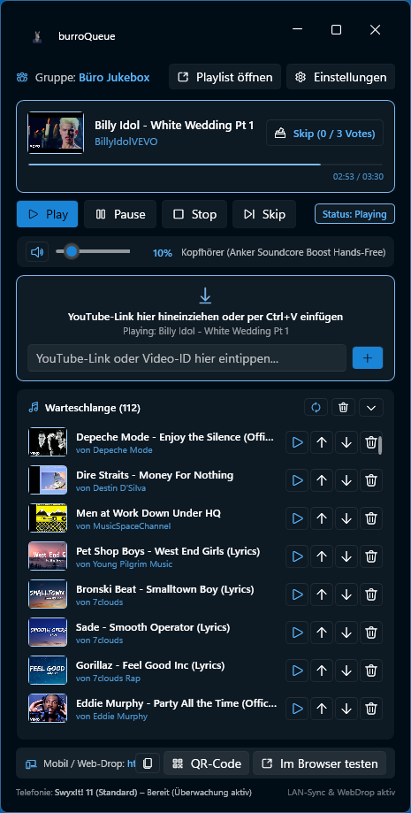
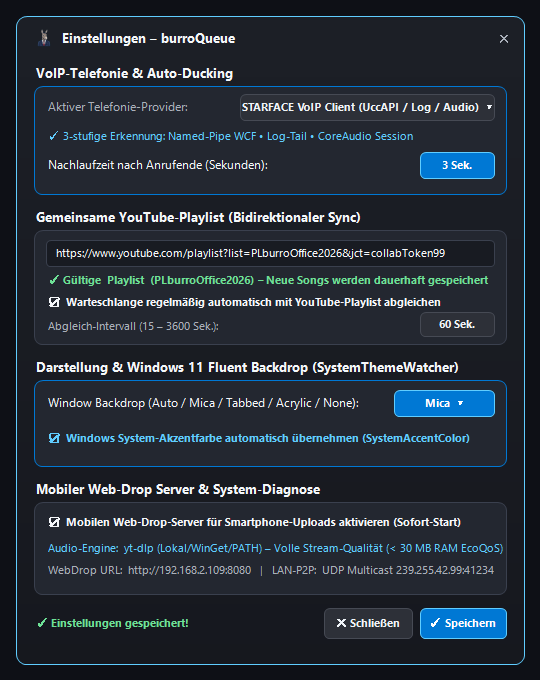

<p align="center">
  
</p>

<h1 align="center">burroQueue</h1>

<p align="center">
  <b>Collaborative Windows 11 Office Jukebox</b><br />
  Featuring VoIP auto-ducking (STARFACE VoIP, SwyxIt! 11 &amp; Windows CoreAudio), bidirectional YouTube collaborative playlist sync, Windows 11 Fluent System Accent &amp; Backdrop integration, E-Core EcoQoS efficiency (&lt; 30 MB RAM), and mobile Web-Drop.
</p>

<p align="center">
  <a href="https://github.com/T-Boyke/burroQueue/actions/workflows/ci.yml">
    
  </a>
  
  
  
  
  
</p>

---

## Screenshots

<p align="center">
  
  &nbsp;&nbsp;
  
</p>

---

## Why "burroQueue"?

In German, an office is a **Büro**. In Spanish, a **burro** is a donkey—a hardworking pack animal that carries heavy loads day in and day out across difficult terrain. In any busy office (*Büro*), coworkers haul through daily sprints, client calls, and engineering deadlines like persistent pack donkeys (*burros*). Yet office music often degenerates into friction: fighting over an AUX cable, locking queues behind proprietary streaming subscriptions, or exposing personal accounts on shared conference hardware.

`burroQueue` resolves this friction by serving as the collective beast of burden. It carries the office musical queue democratically so no single coworker has to act as gatekeeper or DJ. Anyone on the local network can drop a YouTube track into the shared queue via drag-and-drop, clipboard link detection (`Ctrl+V`), or a lightweight mobile browser drop. If someone queues a track that disrupts deep work, the office can vote democratically to skip it without conflict.

---

## Key Features & New Achievements

### 1. Multi-Provider VoIP Auto-Ducking & Configurable Release Delay
- **STARFACE VoIP Client (3-Tier Detection):** Monitors incoming, outgoing, and active calls via the STARFACE Windows Client (`StarfaceUcClient.exe`) using:
  1. **Tier 1 (WCF Named Pipe):** Direct binary `.NET` framing probe against `net.pipe://localhost/StarfaceUcClient/UccService`.
  2. **Tier 2 (Incremental Log Tail):** Zero-allocation tailing of `%LOCALAPPDATA%\STARFACE GmbH\STARFACE Client\Logs\UCC*.log` (`FileShare.ReadWrite`) for `CallStateChanged`, `Ringing`, `Dialing`, `Connected`, and `Disconnected` transitions.
  3. **Tier 3 (CoreAudio Process Session):** Real-time `IAudioSessionControl2` / `IAudioMeterInformation` monitoring of `Starface*` audio sessions.
- **SwyxIt! 11 & Windows CoreAudio:** Native COM event binding (`CLMgr.ClientLineMgr` `DispId(5)`) for SwyxIt! and system-wide communication stream detection via Windows CoreAudio.
- **Configurable Ducking Release Delay (`0–120s`):** When a call or call attempt ends, `burroQueue` waits for a user-configurable release delay (default: `3s`) before smoothly restoring the preset master volume—preventing abrupt music bursts during back-to-back calls. Any new call during the countdown immediately cancels the release timer.

### 2. Bidirectional Collaborative YouTube Playlist Sync
- **Permanent Playlist Write (`YouTubePlaylistWriter`):** Adding a song to the queue automatically appends it permanently to the configured collaborative YouTube playlist (`list=...&jct=...`) via YouTube InnerTube `ACTION_ADD_VIDEO` (`youtubei/v1/browse/edit_playlist`) with collaboration token support.
- **Periodic Background Auto-Sync & Manual Sync:** Configurable background `PeriodicTimer` (`15–3600s`, default `60s`) plus an instant **Sync (`↻`)** button in the queue header keep the local queue synchronized with tracks added directly on YouTube.
- **Reliable Local Audio Playback (`YouTubeAudioStreamResolver`):** Downloads progressive MP4 (`itag 18`) streams to a rolling local cache via `yt-dlp` (avoiding WPF `MediaPlayer` HTTP zone-policy blocks and expired stream URLs) with automatic multi-instance Invidious/Piped fallback.

### 3. Windows 11 Fluent Design, System Accent Colors & Dynamic Backdrops
- **System Accent Color Integration:** Uses `Wpf.Ui` [`ApplicationAccentColorManager`](https://wpfui.lepo.co/documentation/accent.html) (`SystemAccentColorSecondaryBrush`, `SystemAccentColorTertiaryBrush`, `AccentTextFillColorPrimaryBrush`) so badges, active cards, progress bars, and highlights adapt automatically to the user's Windows 11 accent color.
- **Selectable Window Backdrops (`SystemThemeWatcher`):** Full support for [`SystemThemeWatcher`](https://wpfui.lepo.co/documentation/system-theme-watcher.html) with runtime switching between **`Auto`**, **`Mica`**, **`Tabbed`**, **`Acrylic`**, and **`None`** backdrops, plus seamless Dark/Light mode adaptive typography.
- **Right-Docked Queue Controls & Instant Play (`▶`):** All queue item action buttons (**Play Now `▶`**, **Move Up `↑`**, **Move Down `↓`**, **Remove `✕`**) are right-docked in a `DockPanel` so icons align vertically across every row regardless of song title length.
- **Cover-Art Toast Notifications:** Custom borderless Fluent notification window (`TrackToastWindow`) in the bottom-right work area displays the **`64x48` song cover thumbnail** whenever a new track starts playing.

### 4. Extreme Memory & CPU Efficiency (`< 30 MB` RAM & E-Core EcoQoS)
- **Windows 11 EcoQoS & Efficiency Cores:** `ProcessEfficiencyManager` applies `PROCESS_POWER_THROTTLING_EXECUTION_SPEED` and `THREAD_POWER_THROTTLING_EXECUTION_SPEED` via `SetProcessInformation` / `SetThreadInformation` together with `ProcessPriorityClass.Idle`, steering background workers onto Intel Hybrid **E-Cores** / AMD low-power states.
- **Working-Set Trimming & UI Virtualization:** Automatically compacts the Large Object Heap (`GCLargeObjectHeapCompactionMode.CompactOnce`) and invokes Win32 `K32EmptyWorkingSet` when minimizing to the systray or closing dialogs, paired with `VirtualizingStackPanel` (`VirtualizationMode.Recycling`) in the queue view.

### 5. Peer-to-Peer LAN Sync & Instant Mobile Web-Drop (UnoCSS 66.12.0)
- **Zero-Config LAN Discovery:** Discovers office groups over UDP multicast (`239.255.42.99:41234`) for real-time queue synchronization and democratic **Vote-to-Skip**.
- **Instant-Toggle Mobile Web-Drop (`http://<LAN-IP>:<PORT>`):** Toggling the Web-Drop checkbox in Settings immediately starts or stops the embedded HTTP listener, binds to the primary physical LAN IPv4 address (automatically skipping virtual WSL/Hyper-V/Docker adapters and falling back across ports if `8080` is occupied), serves a build-time compiled **UnoCSS 66.12.0** atomic Windows 11 Fluent Light/Dark UI (`< 9 KB`, zero Bootstrap, zero WebView2/Node runtime overhead), and generates an in-app QR code for smartphone uploads.

---

## Architecture & Code Quality

`burroQueue` enforces a 4-layer Domain-Driven Design (DDD) architecture and strict Single Component Per File (1CPF) rules:

```text
src/
├── burroQueue.Domain/          # Pure core business models, events, and exceptions (0 external dependencies)
├── burroQueue.Infrastructure/  # Audio, YouTube InnerTube/yt-dlp, P2P sockets, VoIP (STARFACE/Swyx/CoreAudio), EcoQoS
├── burroQueue.Presentation/    # WPF Fluent UI (Mica/Tabbed/Acrylic), ViewModels (CommunityToolkit.Mvvm), Systray
├── burroQueue.WebDrop/         # Build-time UnoCSS 66.12.0 atomic Fluent CSS compiler (zero Bootstrap, 0 runtime RAM)
└── burroQueue.Tests/           # Comprehensive xUnit, FluentAssertions, and NSubstitute test suite
```

### The 5 Architectural Laws

1. **Pure Domain (DDD):** `burroQueue.Domain` contains core queue, track, voting, and playlist logic. It references **zero** external NuGet packages and **zero** UI or networking namespaces.
2. **Test-Driven Development (TDD):** Every bugfix and feature begins with a failing xUnit test in `src/burroQueue.Tests` before writing production code.
3. **Single Component Per File (1CPF):** Every `.cs` and `.xaml` file contains exactly one type definition (`class`, `interface`, `struct`, `record`, or `enum`). Filenames match the type name exactly.
4. **Performance First (< 30 MB RAM Standby):** No Chromium/Electron/`WebView2` wrappers, EcoQoS E-Core scheduling, working-set trimming, and allocation-free value objects (`readonly record struct`).
5. **Atomic Conventional Commits:** All changes are committed in small, logical increments adhering to Conventional Commits 1.0.0.

Verify architecture compliance at any time:
```powershell
./scripts/verify-architecture.ps1
```

---

## Quickstart

### Prerequisites
- Windows 11 (22H2 or newer recommended)
- [.NET 11 SDK](https://dotnet.microsoft.com/download/dotnet/11.0)
- Optional (only when modifying WebDrop CSS): Node.js 24+ (`npm ci && npm run build:css` in `src/burroQueue.WebDrop`)
- Optional: `yt-dlp` (`winget install yt-dlp.yt-dlp`) for local progressive MP4 audio caching

### Build and Test
```powershell
# Clone repository
git clone https://github.com/T-Boyke/burroQueue.git
cd burroQueue

# Verify architecture constraints (DDD purity & 1CPF)
./scripts/verify-architecture.ps1

# Build solution with warnings treated as errors
dotnet build burroQueue.sln --configuration Release -warnaserror

# Run unit, integration, and E2E tests
dotnet test burroQueue.sln --configuration Release
```

### Launch
```powershell
dotnet run --project src/burroQueue.Presentation/burroQueue.Presentation.csproj
```

---

## CI/CD Workflows & Code Signing

- **Continuous Integration:** [`.github/workflows/ci.yml`](.github/workflows/ci.yml) executes UnoCSS 66.12.0 stylesheet compilation, architecture validation, formatting verification (`dotnet format --verify-no-changes`), `.NET 11` release compilation with `-warnaserror`, and code coverage tests on Windows runners.
- **Release Automation & Authenticode Signing:** [`.github/workflows/release.yml`](.github/workflows/release.yml) publishes self-contained `.NET 11` Windows 11 x64 binaries, signs both `burroQueue.exe` and `burroQueue-Setup-x64.exe` via [SignPath.io](https://about.signpath.io/) (certificate by [SignPath Foundation](https://signpath.org/); see [`SECURITY.md`](SECURITY.md)), and publishes `SHA256SUMS.txt` on Git version tags.
- **Self-Hosted Runner:** Setup script available at [`scripts/runner/setup-runner.ps1`](scripts/runner/setup-runner.ps1) for automated local deployment testing.

---

## License

This project is licensed under the **GNU Affero General Public License v3.0 (AGPL-3.0)**. See the [LICENSE](LICENSE) file for the complete license terms.
